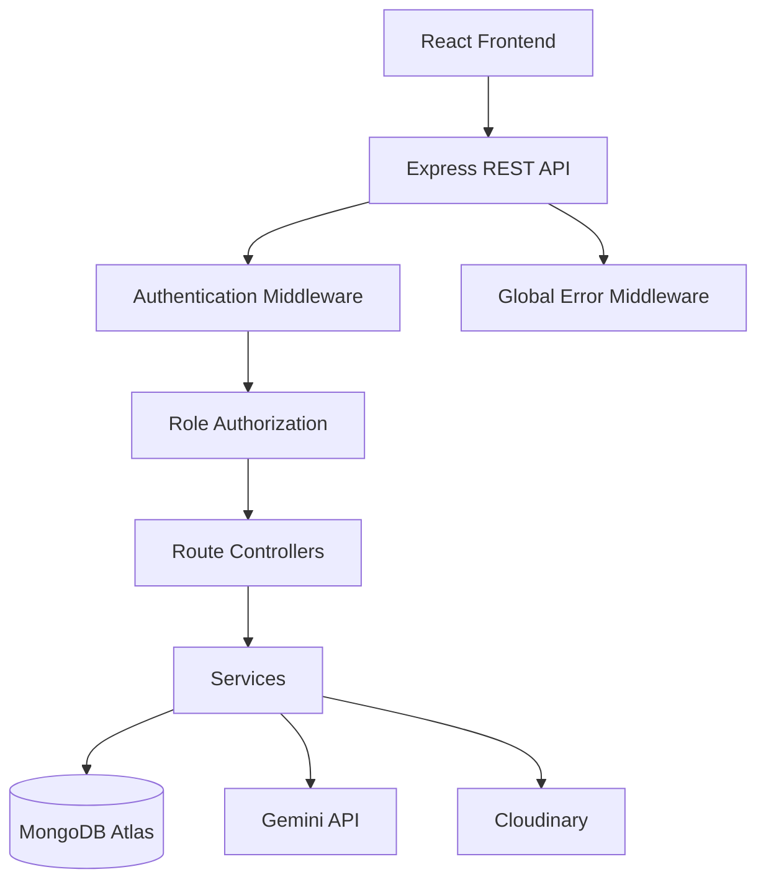
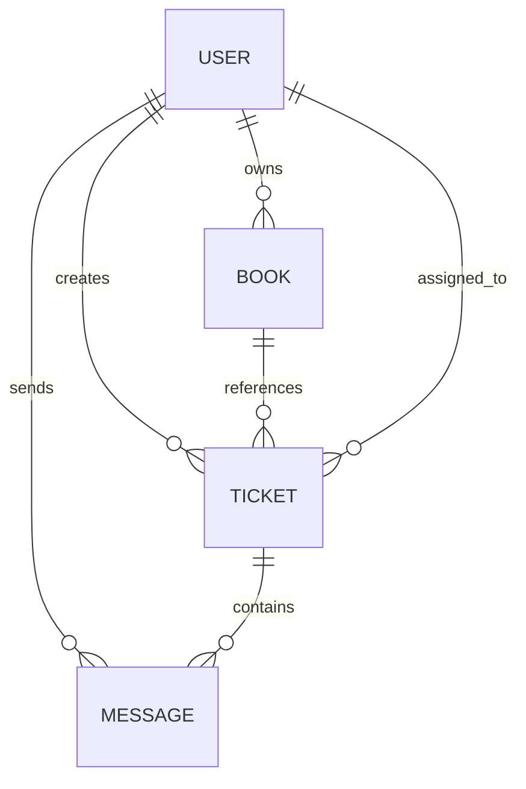
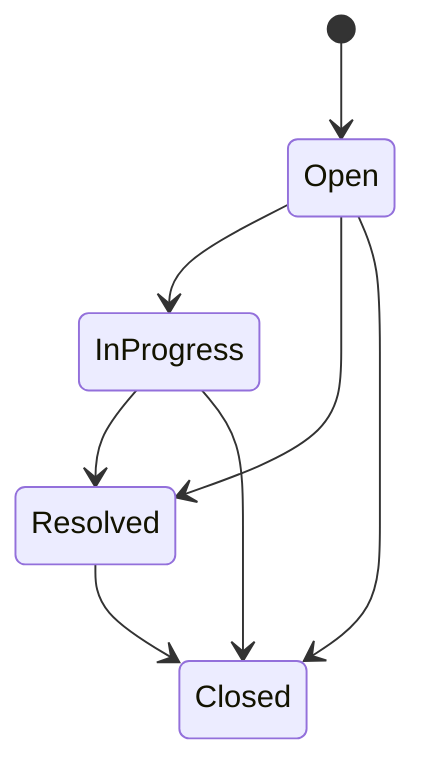
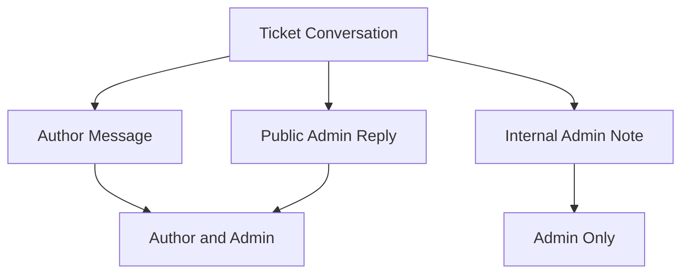
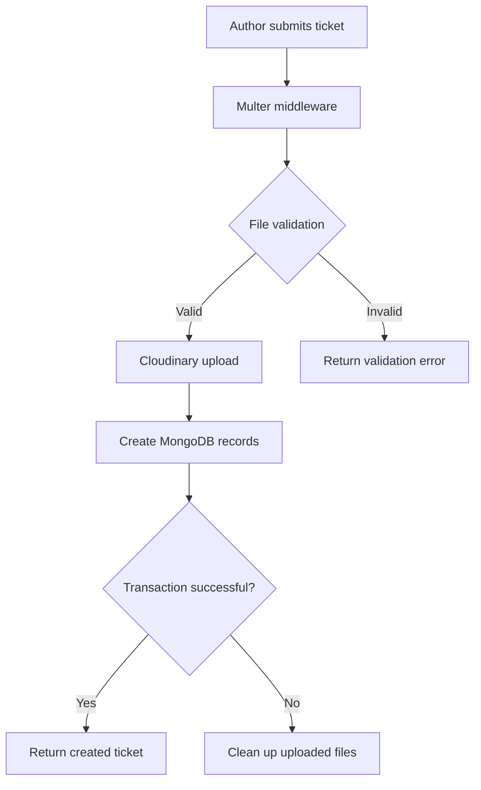

# BookLeaf Author Support & Communication Platform — Backend

A Node.js and Express REST API powering the BookLeaf Author Support & Communication Platform. The backend manages author authentication, book information, support-ticket workflows, administrative operations, file attachments, and AI-assisted ticket classification and response drafting.

---

## Table of Contents

1. [Overview](#1-overview)
2. [Backend Responsibilities](#2-backend-responsibilities)
3. [Technology Stack](#3-technology-stack)
4. [Architecture](#4-architecture)
5. [Project Structure](#5-project-structure)
6. [Database Design](#6-database-design)
7. [Authentication and Authorization](#7-authentication-and-authorization)
8. [API Reference](#8-api-reference)
9. [Ticket Lifecycle](#9-ticket-lifecycle)
10. [AI Integration](#10-ai-integration)
11. [Knowledge Base and Retrieval](#11-knowledge-base-and-retrieval)
12. [File Uploads](#12-file-uploads)
13. [Error Handling and Resilience](#13-error-handling-and-resilience)
14. [Security Considerations](#14-security-considerations)
15. [Dataset and Seeding](#15-dataset-and-seeding)
16. [Environment Configuration](#16-environment-configuration)
17. [Local Development](#17-local-development)
18. [Testing](#18-testing)
19. [Deployment](#19-deployment)
20. [Known Limitations and Future Improvements](#20-known-limitations-and-future-improvements)

---

## 1. Overview

BookLeaf Publishing handles author queries concerning royalties, ISBN and metadata issues, printing quality, distribution, and book production.

The purpose of this backend is to provide a centralized support-management system that enables authors to submit queries and allows administrators to manage those queries efficiently.

The backend exposes a REST API consumed by the React frontend.

It integrates Google's Gemini API to automate two important support operations:

- Automatic ticket classification and priority assignment.
- AI-assisted response drafting using the BookLeaf Knowledge Base.

AI is designed as an assistance layer rather than an autonomous support agent. Administrators retain control over classification overrides and final responses.

## 2. Backend Responsibilities

### Author operations

- Authentication and session management.
- Retrieving author-specific book information.
- Creating support tickets.
- Associating tickets with the correct author and book.
- Uploading ticket attachments.
- Retrieving ticket history and conversations.
- Preventing authors from accessing other authors' records.

### Administrator operations

- Retrieving tickets across all authors.
- Filtering tickets by status, category, priority, and date.
- Searching and paginating ticket queues.
- Updating ticket classification and priority.
- Assigning tickets to administrators.
- Updating ticket status.
- Sending public replies.
- Adding internal notes.
- Generating AI-assisted response drafts.

### Infrastructure operations

- MongoDB connectivity.
- Persistent session storage.
- Cloudinary file storage.
- Gemini API integration.
- Request logging.
- Centralized error handling.
- Health monitoring.

## 3. Technology Stack

| Technology          | Purpose                            |
| ------------------- | ---------------------------------- |
| Node.js             | JavaScript runtime                 |
| Express 5           | REST API framework                 |
| MongoDB Atlas       | Persistent database                |
| Mongoose            | ODM and schema management          |
| express-session     | Session-based authentication       |
| connect-mongo       | Persistent MongoDB session storage |
| bcrypt              | Password hashing                   |
| google-auth-library | Google authentication support      |
| @google/genai       | Gemini API integration             |
| Multer              | Multipart file processing          |
| Cloudinary          | Attachment storage                 |
| cors                | Cross-origin request handling      |
| cookie-parser       | Cookie parsing                     |
| dotenv              | Environment configuration          |

**Module system:** Native JavaScript ES Modules.

## 4. Architecture

The backend follows a layered architecture separating routing, request handling, business logic, data persistence, and external integrations.

### High-level architecture



### Request lifecycle

1. The frontend sends an HTTP request.
2. Express receives the request and executes applicable middleware.
3. Authentication middleware verifies the session.
4. Role-based middleware checks permissions where required.
5. The route invokes its controller.
6. The controller validates and processes the request.
7. Services handle reusable business logic and external integrations.
8. Mongoose interacts with MongoDB.
9. The controller returns an HTTP response.
10. Errors are forwarded to centralized error handling when necessary.

### Separation of concerns

| Layer          | Responsibility                                                |
| -------------- | ------------------------------------------------------------- |
| Routes         | Define HTTP methods, endpoint paths, and middleware           |
| Controllers    | Handle HTTP requests and responses                            |
| Services       | Encapsulate reusable business logic and external integrations |
| Models         | Define MongoDB schemas and relationships                      |
| Middleware     | Authentication, authorization, uploads, logging, and errors   |
| Configurations | Initialize external services and application configuration    |
| Data           | Store seed data and the AI knowledge base                     |

## 5. Project Structure

```text
backend/
│
├── client-auth-secret.json
│
├── data/
│   ├── bookleaf.knowledge-base.js
│   └── bookleaf_sample_data.json
│
├── scripts/
│   └── seed.js
│
├── src/
│   ├── app.js
│   ├── server.js
│   │
│   ├── configs/
│   │   ├── cloudinary.config.js
│   │   ├── env.config.js
│   │   ├── gemini.config.js
│   │   ├── mongoose.connect.js
│   │   ├── session.config.js
│   │   └── upload.config.js
│   │
│   ├── controllers/
│   │   ├── admin.ticket.controller.js
│   │   ├── auth.controller.js
│   │   ├── book.controller.js
│   │   ├── home.controller.js
│   │   └── ticket.controller.js
│   │
│   ├── middlewares/
│   │   ├── auth.middleware.js
│   │   ├── globalError.middleware.js
│   │   ├── logger.middleware.js
│   │   └── upload.middleware.js
│   │
│   ├── models/
│   │   ├── book.model.js
│   │   ├── message.model.js
│   │   ├── ticket.model.js
│   │   └── user.model.js
│   │
│   ├── routes/
│   │   ├── admin.ticket.routes.js
│   │   ├── auth.routes.js
│   │   ├── book.routes.js
│   │   ├── home.routes.js
│   │   └── ticket.routes.js
│   │
│   ├── services/
│   │   ├── ai-classification.service.js
│   │   ├── ai-response-draft.service.js
│   │   ├── cloudinary.service.js
│   │   ├── googleAuth.service.js
│   │   ├── knowledge-base.service.js
│   │   └── ticket.service.js
│   │
│   ├── utils/
│   ├── validators/
│   └── views/
│
└── test/
    └── ai-classification.test.js
```

## 6. Database Design

MongoDB is the primary database, with Mongoose providing schema definitions, validation, references, and query operations.

The application uses four primary collections.

### 6.1 User

Represents authors and administrators.

| Field         | Description                                         |
| ------------- | --------------------------------------------------- |
| `author_id`   | External author identifier                          |
| `name`        | User's name                                         |
| `email`       | Email address                                       |
| `phone`       | Contact number                                      |
| `city`        | City                                                |
| `joined_date` | Registration date                                   |
| `role`        | `author` or `admin`                                 |
| `google_sub`  | Google account subject identifier, where applicable |

### 6.2 Book

Stores book information and royalty statistics.

| Field                      | Description                      |
| -------------------------- | -------------------------------- |
| `book_id`                  | External book identifier         |
| `author`                   | Reference to User                |
| `title`                    | Book title                       |
| `isbn`                     | ISBN                             |
| `genre`                    | Book genre                       |
| `publication_date`         | Publication date                 |
| `status`                   | Production or publication status |
| `mrp`                      | Maximum retail price             |
| `author_royalty_per_copy`  | Author royalty per copy          |
| `total_copies_sold`        | Total copies sold                |
| `total_royalty_earned`     | Accumulated royalty              |
| `royalty_paid`             | Royalty already paid             |
| `royalty_pending`          | Outstanding royalty              |
| `last_royalty_payout_date` | Last payout date                 |
| `print_partner`            | Printing partner                 |
| `available_on`             | Distribution platforms           |

Books are associated with their respective authors. Author queries must be scoped to the authenticated author.

### 6.3 Ticket

Represents a support request.

| Field                | Description                          |
| -------------------- | ------------------------------------ |
| `author`             | Reference to User                    |
| `book`               | Optional reference to Book           |
| `subject`            | Ticket subject                       |
| `status`             | Current ticket status                |
| `category`           | Support category                     |
| `categorySource`     | AI, admin, or default                |
| `priority`           | Critical, High, Medium, or Low       |
| `prioritySource`     | AI, admin, or default                |
| `assignedTo`         | Administrator assigned to the ticket |
| `aiProcessingStatus` | AI processing state                  |
| `aiProcessingError`  | AI failure information               |
| `aiDraft`            | Generated response draft             |
| `lastMessageAt`      | Last message timestamp               |
| `lastActivityAt`     | Last ticket activity                 |
| `resolvedAt`         | Resolution timestamp                 |
| `closedAt`           | Closure timestamp                    |

### 6.4 Message

Stores the conversation associated with a ticket.

| Field         | Description                                 |
| ------------- | ------------------------------------------- |
| `ticket`      | Reference to Ticket                         |
| `sender`      | Reference to User                           |
| `senderRole`  | Author or admin                             |
| `type`        | Author query, admin reply, or internal note |
| `visibility`  | Public or internal                          |
| `content`     | Message body                                |
| `attachments` | Attachment metadata                         |

Authors can retrieve public messages, while administrators can retrieve public and internal messages.

Internal notes must never be exposed through author-facing endpoints.

### Relationship diagram



## 7. Authentication and Authorization

The application uses session-based authentication.

## Author Account Onboarding & Authentication

BookLeaf supports role-based authentication for both Authors and Administrators.

### Authentication Methods

- **Email & Password:** Users authenticate using their registered email address and password.
- **Google OAuth:** Existing Google Sign-In support is available for linked accounts.
- **Session Management:** Express sessions maintain authenticated user state across requests.
## Demo Credentials

### Administrator Account

The application includes a pre-seeded administrator account.

| Field | Value |
|---|---|
| Email | `admin@bookleaf.demo` |
| Password | Use the administrator password configured through `ADMIN_PASSWORD` in the backend environment variables |
| Portal | `/admin` |

**Administrator setup:**
- Configure `ADMIN_NAME`, `ADMIN_EMAIL`, and `ADMIN_PASSWORD` in the backend `.env` file.
- Run the database seed script to provision the administrator account.
- The administrator password is hashed using bcrypt before storage.
- The seed script does not overwrite an existing administrator's password on subsequent runs.

### Author Accounts

Author accounts are provisioned from the supplied sample dataset.

- Authors receive password-setup invitations generated during database seeding.
- Open an invitation link to configure an account password.
- After password setup, log in using the author's registered email and newly configured password.
- Authors are redirected to the `/author` portal after successful authentication.

**Note:** Never commit actual passwords, invitation tokens, or environment files to the repository.
### Author Onboarding

Author accounts are provisioned through the database seeding process. Authors receive a password-setup invitation rather than registering publicly.

The onboarding process works as follows:

1. The seed script creates or updates author records using the supplied dataset.
2. A unique, cryptographically generated invitation token is created for authors who have not set a password.
3. Only the SHA-256 hash of the invitation token is stored in MongoDB.
4. The invitation URL directs the author to the frontend password-setup page.
5. The author submits a new password and confirmation.
6. The backend validates the token, checks its expiration, hashes the password using bcrypt, and updates the author account.
7. Once completed, the author can log in using their registered email and password.

**Invitation security:**

- Invitation tokens are generated using Node.js cryptographic randomness.
- Tokens expire after 15 minutes.
- Passwords must contain at least 12 characters.
- Passwords are hashed using bcrypt before database storage.
- Public author registration is not enabled.

### Authentication API Endpoints

| Method | Endpoint             | Description                                             |
| ------ | -------------------- | ------------------------------------------------------- |
| POST   | `/auth/login`        | Authenticate using email/password or Google credentials |
| GET    | `/auth/me`           | Retrieve the currently authenticated user               |
| POST   | `/auth/logout`       | Destroy the current session                             |
| POST   | `/auth/set-password` | Set an author's password using an invitation token      |

### Role-Based Access Control

The application supports two roles:

- **Author:** Can access their own books, tickets, and account information.
- **Admin:** Can access the administrative dashboard, author directory, and support ticket management features.

Protected routes use authentication and role-based authorization middleware to enforce access restrictions.

### Authorization

The application distinguishes between two roles:

| Role   | Permissions                                |
| ------ | ------------------------------------------ |
| Author | Access their own books and support tickets |
| Admin  | Manage tickets across all authors          |

The `requireRole()` middleware protects role-specific endpoints.

Example:

```javascript
router.get("/", requireRole("admin"), handleGetAdminTickets)
```

### Author data isolation

Authorization also validates resource ownership.

When an author requests a ticket:

- The ticket identifier is validated.
- The ticket must exist.
- The ticket must belong to the authenticated author.
- Only public conversation messages are returned.

This prevents horizontal privilege escalation.

## 8. API Reference

All endpoints are relative to the prefixes registered by the Express application.

### 8.1 Health and home

| Method | Endpoint  | Description                        | Access |
| ------ | --------- | ---------------------------------- | ------ |
| GET    | `/`       | Home endpoint                      | Public |
| GET    | `/health` | Database connectivity health check | Public |

#### `GET /health`

Checks MongoDB connection state.

Healthy response:

```json
{
  "status": "OK",
  "database": "Connected"
}
```

Unhealthy response:

```json
{
  "status": "UNHEALTHY",
  "database": "Disconnected"
}
```

Returns HTTP `503` when the database is disconnected.

### 8.2 Authentication routes

Prefix: `/auth`

| Method | Endpoint       | Description                             |
| ------ | -------------- | --------------------------------------- |
| POST   | `/auth/login`  | Authenticate a user                     |
| GET    | `/auth/me`     | Retrieve the current authenticated user |
| POST   | `/auth/logout` | End the current session                 |

#### `POST /auth/login`

Authenticates a user and establishes a session.

The exact accepted request fields are defined by the authentication controller.

#### `GET /auth/me`

Retrieves the currently authenticated user. Used by the frontend to restore authentication state.

#### `POST /auth/logout`

Destroys the current authenticated session.

### 8.3 Author book routes

Prefix: `/api/books`

| Method | Endpoint     | Access | Description                               |
| ------ | ------------ | ------ | ----------------------------------------- |
| GET    | `/api/books` | Author | Retrieve the authenticated author's books |

The backend derives the author identity from the authenticated session rather than trusting an author identifier supplied by the frontend.

### 8.4 Author ticket routes

Prefix: `/api/tickets`

| Method | Endpoint                 | Access | Description                                   |
| ------ | ------------------------ | ------ | --------------------------------------------- |
| POST   | `/api/tickets`           | Author | Create a support ticket                       |
| GET    | `/api/tickets`           | Author | Retrieve the author's tickets                 |
| GET    | `/api/tickets/:ticketId` | Author | Retrieve a ticket and its public conversation |

#### `POST /api/tickets`

Creates a support ticket.

Middleware sequence:

1. Author authentication and authorization.
2. Attachment processing.
3. Ticket controller execution.

Supported ticket information includes:

- Subject.
- Description.
- Optional associated book.
- Optional file attachments.

A ticket can be associated with a specific book or submitted as a general/account-level query.

The backend validates that an associated book belongs to the authenticated author.

Ticket and initial message creation use a MongoDB transaction. If database persistence fails after files have been uploaded, uploaded Cloudinary resources are cleaned up as part of rollback handling.

AI classification is performed independently of the core ticket-creation operation. An AI failure should not prevent the author from submitting a support request.

#### `GET /api/tickets`

Retrieves tickets belonging to the authenticated author, including ticket information and pagination where supported.

#### `GET /api/tickets/:ticketId`

Retrieves an individual author ticket.

The backend validates the ticket identifier, checks ownership, returns ticket information, retrieves public messages, and excludes internal administrator notes.

### 8.5 Administrator ticket routes

Prefix: `/api/admin/tickets`

Every route uses `requireRole("admin")`.

| Method | Endpoint                                      | Description                                   |
| ------ | --------------------------------------------- | --------------------------------------------- |
| GET    | `/api/admin/tickets`                          | Retrieve and filter the admin ticket queue    |
| GET    | `/api/admin/tickets/:ticketId`                | Retrieve ticket details and full conversation |
| PATCH  | `/api/admin/tickets/:ticketId/status`         | Update ticket status                          |
| PATCH  | `/api/admin/tickets/:ticketId/assign`         | Assign ticket to current admin                |
| POST   | `/api/admin/tickets/:ticketId/messages`       | Send public reply or internal note            |
| POST   | `/api/admin/tickets/:ticketId/draft`          | Generate an AI response draft                 |
| PATCH  | `/api/admin/tickets/:ticketId/classification` | Override category and/or priority             |

#### `GET /api/admin/tickets`

Supported filters:

| Parameter  | Purpose                    |
| ---------- | -------------------------- |
| `status`   | Filter by ticket status    |
| `category` | Filter by support category |
| `priority` | Filter by priority         |
| `fromDate` | Inclusive start date       |
| `toDate`   | Inclusive end date         |
| `search`   | Search ticket information  |
| `page`     | Pagination page            |
| `limit`    | Number of results per page |

The queue prioritizes tickets by:

1. Critical, High, Medium, Low.
2. Oldest ticket first within the same priority.

Date filtering uses an inclusive date range, with the end date handled as the next day's exclusive boundary.

#### `GET /api/admin/tickets/:ticketId`

Returns ticket information, author information, associated book, assigned administrator, and full conversation history, including internal notes.

#### `PATCH /api/admin/tickets/:ticketId/status`

Supported statuses:

- `Open`
- `In Progress`
- `Resolved`
- `Closed`

Relevant lifecycle timestamps are maintained by the controller.

#### `PATCH /api/admin/tickets/:ticketId/assign`

Assigns the ticket to the currently authenticated administrator.

#### `POST /api/admin/tickets/:ticketId/messages`

Creates an administrator conversation message.

Supported message types:

- Public administrator reply.
- Internal administrator note.

Public replies are visible to authors. Internal notes are restricted to administrators.

Message creation and ticket activity updates are handled together using a database transaction.

#### `POST /api/admin/tickets/:ticketId/draft`

Generates an AI-assisted response using ticket context, public conversation history, associated book information where applicable, and relevant BookLeaf Knowledge Base information.

The generated draft is returned for administrator review and editing before sending.

#### `PATCH /api/admin/tickets/:ticketId/classification`

Allows administrators to override classification.

Supported categories:

- `Royalty & Payments`
- `ISBN & Metadata Issues`
- `Printing & Quality`
- `Distribution & Availability`
- `Book Status & Production Updates`
- `General Inquiry`

Supported priorities:

- `Critical`
- `High`
- `Medium`
- `Low`

Category and priority can be updated independently. Their source fields are updated to indicate an administrator override.

## 9. Ticket Lifecycle



Administrators manage ticket status through the status update endpoint.

### Message visibility



Visibility is enforced by backend query logic, not merely by frontend presentation.

## 10. AI Integration

AI is integrated using Google's Gemini API through the `@google/genai` SDK.

Two separate services handle classification and response generation.

### 10.1 Automatic classification

Service: `src/services/ai-classification.service.js`

When a ticket is created, the classification service attempts to determine:

- Support category.
- Priority.
- Reasoning.
- Confidence.

The model is instructed to return structured JSON. Its output is validated against supported application values before persistence.

Categories:

1. Royalty & Payments
2. ISBN & Metadata Issues
3. Printing & Quality
4. Distribution & Availability
5. Book Status & Production Updates
6. General Inquiry

Priority levels:

| Priority | Meaning                                              |
| -------- | ---------------------------------------------------- |
| Critical | Severe or urgent issue requiring immediate attention |
| High     | Significant issue requiring prompt investigation     |
| Medium   | Normal support request                               |
| Low      | Routine informational request                        |

The ticket records whether its classification originated from AI, an administrator, or a default value.

### 10.2 AI response drafting

Service: `src/services/ai-response-draft.service.js`

When an administrator opens a ticket, an AI-generated response can be requested.

The generation process considers ticket subject, original query, relevant public conversation history, associated book context, and relevant knowledge-base information.

The prompt encourages responses that are empathetic, professional, specific, grounded in BookLeaf policies, and clear about next steps.

The model is instructed not to invent dates, claim actions have been completed, or disclose internal notes.

AI-generated content is never sent to an author automatically.

### 10.3 Model configuration

The model is configured through environment variables.

```javascript
import { GoogleGenAI } from "@google/genai"

const apiKey = process.env.GEMINI_API_KEY

export const gemini = apiKey ? new GoogleGenAI({ apiKey }) : null

export const AI_MODEL = process.env.GEMINI_MODEL || "gemini-2.5-flash"
```

The deployed model identifier is controlled through `GEMINI_MODEL`.

Gemini Flash is used for structured classification and short support-response generation.

### 10.4 Graceful degradation

AI is not a hard dependency for ticket creation.

If Gemini is unavailable, rate-limited, or returns unusable output:

- The author can still submit a ticket.
- The ticket remains stored in MongoDB.
- AI processing can be marked as failed.
- The failure is recorded for troubleshooting.
- Administrators can classify tickets manually.
- Administrators can write and send replies without AI assistance.

The classification service includes retry handling for temporary provider failures.

### 10.5 Cost awareness

The application uses category-based knowledge-base retrieval rather than sending the entire knowledge base with every request.

Relevant ticket context and public conversation information are used for response generation.

This reduces unnecessary prompt context and avoids exposing unrelated internal conversation data to the model.

Output token limits and retry handling are also used to control generation behavior.

## 11. Knowledge Base and Retrieval

Knowledge base:

`data/bookleaf.knowledge-base.js`

Retrieval service:

`src/services/knowledge-base.service.js`

The retrieval service selects relevant knowledge-base sections based on the ticket category.

Relevant communication guidelines and sample scenarios are included to help maintain consistent support responses.

| Topic                    | Policy information                                     |
| ------------------------ | ------------------------------------------------------ |
| Company Overview         | Publishing services and packages                       |
| Royalty & Payments       | Royalty split, deductions, payout cycle and threshold  |
| ISBN & Metadata          | ISBN ownership, imprint and correction procedures      |
| Printing & Quality       | Printing timelines and defect handling                 |
| Distribution             | Platforms, listing timelines and stock synchronization |
| Production               | Book production stages and possible delays             |
| Communication Guidelines | Expected support tone and response structure           |
| Sample Scenarios         | Example author queries and expected responses          |

### Important BookLeaf policies

**Royalty policy**

- 80% of net profit goes to the author.
- 20% of net profit goes to BookLeaf.
- Net profit is calculated after printing costs, platform commission and shipping.
- Royalties are calculated quarterly.
- Payouts are made within 45 days after quarter-end.
- The minimum payout threshold is ₹1,000.
- Amounts below the threshold roll over to the next quarter.
- Payments are made by bank transfer.

**ISBN policy**

- Each BookLeaf-published book receives a unique ISBN.
- ISBNs are registered under BookLeaf's publisher imprint.
- Authors wanting their own imprint must obtain their ISBN independently.
- Duplicate or incorrectly linked ISBN issues require high-priority escalation.

**Printing and quality**

- Standard printing turnaround is 5–7 business days after order confirmation.
- Verified printing defects qualify for a free reprint.
- Authors may be asked to provide photographs of defective copies.

**Distribution**

Supported platforms include Amazon India, Flipkart, Amazon US, Amazon UK and the BookLeaf Store.

- New listings generally take 7–10 business days.
- Stock synchronization issues may require 24–48 hours.

**Production stages**

```text
Manuscript Received
        ↓
Editing (if opted)
        ↓
Cover Design
        ↓
Typesetting
        ↓
Proofreading
        ↓
ISBN Assignment
        ↓
Printing
        ↓
Distribution Setup
        ↓
Published & Live
```

## 12. File Uploads

File upload handling is implemented using Multer and Cloudinary.

### Upload flow



### Upload configuration

Supported files:

- PDF.
- JPEG.
- PNG.

| Restriction             | Limit         |
| ----------------------- | ------------- |
| Maximum file size       | 5 MB per file |
| Maximum number of files | 3             |
| Storage                 | Cloudinary    |

Multer uses memory storage before files are passed to Cloudinary.

Attachment metadata is stored with the corresponding message, including original filename, MIME type, file size, URL and Cloudinary public identifier.

If database persistence fails after a successful upload, uploaded resources are cleaned up to avoid orphaned files.

## 13. Error Handling and Resilience

Centralized error handling:

`src/middlewares/globalError.middleware.js`

Request logging:

`src/middlewares/logger.middleware.js`

| Scenario                          | Expected handling                         |
| --------------------------------- | ----------------------------------------- |
| Invalid MongoDB ObjectId          | Reject request with a client error        |
| Nonexistent ticket                | Return not-found response                 |
| Access to another author's ticket | Reject access                             |
| Missing authentication            | Reject protected request                  |
| Incorrect role                    | Reject unauthorized operation             |
| Invalid ticket status             | Reject invalid value                      |
| Invalid category or priority      | Reject invalid value                      |
| Invalid date format               | Reject filter request                     |
| Invalid attachment type           | Reject upload                             |
| Attachment too large              | Reject upload                             |
| AI provider unavailable           | Preserve ticket and allow manual handling |
| MongoDB disconnected              | Health endpoint reports unhealthy         |

The application distinguishes client-side errors, authorization failures, missing resources and infrastructure failures.

## 14. Security Considerations

### Session security

- Authentication uses server-side sessions.
- Session data is stored in MongoDB.
- Session cookies identify authenticated requests.
- Session secrets are configured through environment variables.

### Proxy configuration

The Express application uses:

```javascript
app.set("trust proxy", 1)
```

This is important when the backend is deployed behind a trusted reverse proxy, such as Render, and uses secure session cookies.

### CORS configuration

The backend uses an explicit origin allowlist.

Configured origins:

- `http://localhost:5174`
- `http://localhost:5173`
- The origin configured by `FRONTEND_URL`

CORS configuration:

```javascript
const allowedOrigins = [
  "http://localhost:5174",
  "http://localhost:5173",
  process.env.FRONTEND_URL,
].filter(Boolean)

app.use(
  cors({
    origin: allowedOrigins,
    methods: ["GET", "POST", "PATCH", "PUT", "DELETE", "OPTIONS"],
    allowedHeaders: ["Content-Type", "Authorization"],
    credentials: true,
  })
)
```

Credential support is enabled to allow browser requests to include session cookies.

### Role-based access control

- Author endpoints require the author role.
- Administrator endpoints require the administrator role.
- Authorization is enforced by backend middleware.

### AI API security

The Gemini API key is stored on the backend and is never intended to be exposed through frontend code.

### File uploads

The upload middleware restricts file types, file sizes and file counts.

### Secret management

The following must not be committed to a public repository:

- `.env` files.
- Gemini API keys.
- MongoDB credentials.
- Cloudinary credentials.
- Session secrets.
- Google authentication credentials.
- `client-auth-secret.json` if it contains private credentials.

The assignment solution should remain in a private repository.

## 15. Dataset and Seeding

The supplied dataset is located at:

`data/bookleaf_sample_data.json`

It contains:

- 10 authors.
- 18 books.

The dataset includes different publication states, royalty figures, sales numbers and distribution details.

It intentionally covers:

- Published books earning royalties.
- Pending royalty payouts.
- Zero-payout cases.
- Books still in production.

The seed script is located at:

`scripts/seed.js`

Run:

```bash
npm run seed
```

The seed script:

1. Connects to the configured database.
2. Clears the relevant existing collections.
3. Processes the supplied sample records.
4. Upserts the records into MongoDB.

**Important:** The seed operation clears existing records before repopulating the sample dataset. Run it only against the intended development or demonstration database. Do not run it against a database containing data that must be retained.

The configured script loads `.env.production`:

```json
{
  "seed": "node --env-file=.env.production scripts/seed.js"
}
```

## 16. Environment Configuration

Create an environment file in the backend directory.

| Variable                | Purpose                                 |
| ----------------------- | --------------------------------------- |
| `PORT`                  | Express server port                     |
| `FRONTEND_URL`          | Allowed frontend origin                 |
| `MONGO_URI`             | MongoDB connection string               |
| `GOOGLE_CLIENT_ID`      | Google authentication client identifier |
| `SESSION_SECRET`        | Session signing secret                  |
| `CLOUDINARY_CLOUD_NAME` | Cloudinary account name                 |
| `CLOUDINARY_API_KEY`    | Cloudinary API key                      |
| `CLOUDINARY_API_SECRET` | Cloudinary API secret                   |
| `GEMINI_API_KEY`        | Gemini API key                          |
| `GEMINI_MODEL`          | Gemini model identifier                 |
| `AI_PROVIDER`           | AI provider configuration               |

Example `.env.example`:

```env
PORT=3000

FRONTEND_URL=http://localhost:5173

MONGO_URI=

GOOGLE_CLIENT_ID=

SESSION_SECRET=

CLOUDINARY_CLOUD_NAME=
CLOUDINARY_API_KEY=
CLOUDINARY_API_SECRET=

GEMINI_API_KEY=
GEMINI_MODEL=
AI_PROVIDER=gemini
```

Use the exact model identifier configured in the deployed environment.

Never commit actual credentials.

## 17. Local Development

### Prerequisites

- Node.js compatible with the project.
- npm.
- MongoDB Atlas account or accessible MongoDB instance.
- Gemini API key.
- Cloudinary account.
- Google OAuth client configuration if using Google authentication.

### Step 1: Clone the repository

```bash
git clone <PRIVATE_REPOSITORY_URL>
```

### Step 2: Navigate to the backend

```bash
cd author-support-communication-platform/backend
```

### Step 3: Install dependencies

```bash
npm install
```

### Step 4: Configure environment variables

Create `.env.development` and populate the required values.

Ensure that the frontend origin matches the local Vite development server.

### Step 5: Start the backend

```bash
npm run dev
```

The development script runs the server using Nodemon.

### Step 6: Verify database connectivity

Open:

```text
http://localhost:3000/health
```

A healthy application should return:

```json
{
  "status": "OK",
  "database": "Connected"
}
```

### Available scripts

| Command        | Description                             |
| -------------- | --------------------------------------- |
| `npm run dev`  | Start development server with Nodemon   |
| `npm start`    | Start production server                 |
| `npm run seed` | Clear and repopulate the sample dataset |

## 18. Testing

The backend includes an AI classification test:

`test/ai-classification.test.js`

Run it using:

```bash
node --env-file=.env.production test/ai-classification.test.js
```

This test exercises classification scenarios against the configured Gemini model.

AI integration tests require a valid API key and available provider quota.

### Recommended API test scenarios

**Authentication**

- Login successfully.
- Retrieve the current user.
- Logout.
- Access protected endpoints without authentication.
- Attempt administrator routes as an author.

**Author isolation**

- Log in as Author A and retrieve books and tickets.
- Log in as Author B.
- Confirm Author B cannot access Author A's resources.
- Attempt to access another author's ticket by identifier.

**Ticket creation**

- Create a ticket linked to a book.
- Create a general/account-level ticket.
- Submit a ticket with attachments.
- Submit an invalid book reference.
- Submit an oversized or unsupported attachment.

**Administrator operations**

- Retrieve the ticket queue.
- Filter by status, category and priority.
- Filter by date range.
- Search and paginate.
- Update ticket status.
- Assign a ticket.
- Override AI classification.
- Send a public reply.
- Add an internal note.
- Generate an AI draft.

**Conversation visibility**

- Confirm administrators can see internal notes.
- Confirm authors cannot retrieve internal notes.
- Confirm public replies appear in the author's conversation.

**AI failure handling**

- Test classification with a valid API key.
- Test provider unavailability and rate limits.
- Verify ticket creation remains available.
- Verify administrators can manually reply without AI.

## 19. Deployment

The application uses the following services:

| Service       | Responsibility                          |
| ------------- | --------------------------------------- |
| Render        | Backend hosting                         |
| MongoDB Atlas | Database                                |
| Cloudinary    | Attachment storage                      |
| Gemini API    | AI classification and response drafting |
| Vercel        | Frontend hosting                        |

### Backend deployment

**Live backend:**

https://author-support-communication-platform.onrender.com/

Production start command:

```bash
npm start
```

The production environment variables are configured through the Render service settings.

Deployment considerations:

- Configure the MongoDB connection string.
- Configure the frontend origin through `FRONTEND_URL`.
- Ensure session cookies work with the deployed cross-origin frontend.
- Keep `trust proxy` configured appropriately for Render.
- Configure a strong session secret.
- Verify Cloudinary and Gemini credentials.
- Check the health endpoint after deployment.

### Frontend deployment

The frontend is hosted separately on Vercel.

https://author-support-communication-platfo.vercel.app/

The frontend communicates with the backend through the configured API base URL.

## 20. Known Limitations and Future Improvements

The current implementation focuses on the core assignment requirements.

Potential future improvements include:

1. **WebSockets or Server-Sent Events:** Replace periodic polling with event-driven communication to reduce unnecessary requests and improve update latency.
2. **Automated integration tests:** Expand coverage across authentication, authorization, ticket lifecycle, and transaction behavior.
3. **AI evaluation:** Introduce repeatable evaluation datasets with classification accuracy metrics and response-quality scoring.
4. **Structured observability:** Add centralized logging, metrics, tracing, and AI-provider usage monitoring.
5. **Background processing:** Move AI classification and other potentially slow operations to a background job queue.
6. **Advanced knowledge retrieval:** Introduce embeddings or semantic retrieval if the knowledge base grows substantially.
7. **Rate limiting:** Add configurable request limits to protect authentication and support endpoints.
8. **API specification:** Maintain a formal OpenAPI specification for automated API documentation and client generation.

---

## Final Notes

This backend is designed around a central principle:

**AI should improve the efficiency and consistency of author support without becoming a dependency for the underlying support workflow.**

Ticket creation, authorization, persistence, and administrator-controlled communication remain application responsibilities. AI provides classification and drafting assistance while administrators retain final control over support decisions and messages.

# BookLeaf Author Communication & Support — Frontend

The frontend for the **BookLeaf Author Support & Communication Platform**, a web application that provides separate author-facing and admin-facing interfaces for managing books, support tickets, and author communications.

The application is built with React and React Router. It communicates with the backend through a REST API and supports role-based navigation, ticket management, AI-assisted response drafting, and near-real-time ticket updates.

## Live Application

- **Frontend:** https://author-support-communication-platfo.vercel.app/
- **Backend API:** https://author-support-communication-platform.onrender.com/

## 1. Technology Stack

| Technology              | Purpose                                                   |
| ----------------------- | --------------------------------------------------------- |
| React 19                | Component-based UI                                        |
| React Router 8          | Routing, nested layouts, loaders, actions, and navigation |
| Vite                    | Development server and production build                   |
| Tailwind CSS            | Utility-first styling                                     |
| JavaScript (ES Modules) | Application logic                                         |
| Fetch API               | Backend communication                                     |
| Google OAuth            | Google sign-in integration                                |

## 2. Application Architecture

The frontend follows a feature-oriented structure with a clear separation between routing, UI components, data loading, mutations, and API communication.

### Architecture responsibilities

- **Pages:** Render the author and admin application screens.
- **Layouts:** Provide separate navigation and structural layouts for authors and administrators.
- **Components:** Reusable UI elements for tickets, books, status indicators, filters, and common states.
- **Loaders:** Retrieve data before route components render.
- **Actions:** Handle form submissions and route-level mutations.
- **Services:** Encapsulate HTTP requests to backend endpoints.
- **Config:** Centralizes the backend API base URL.

### Data flow

```text
User Interaction
       |
       v
React Router
       |
       +------> Loader ------> API Service ------> Backend REST API
       |                                          |
       |                                          v
       |                                     MongoDB
       |
       +------> Action ------> API Service ------> Backend REST API
       |
       v
React Components
       |
       v
Rendered UI
```

React Router's data APIs are used to keep data fetching and mutations close to their respective routes.

## 3. Project Structure

```text
frontend/
├── public/
├── src/
│   ├── actions/
│   │   ├── admin-ticket.action.js
│   │   ├── auth.action.js
│   │   └── ticket.action.js
│   │
│   ├── app/
│   │   ├── App.jsx
│   │   └── router.jsx
│   │
│   ├── components/
│   │   ├── books/
│   │   │   └── BooksTable.jsx
│   │   ├── common/
│   │   │   ├── EmptyState.jsx
│   │   │   ├── ErrorState.jsx
│   │   │   ├── PageLoader.jsx
│   │   │   ├── Pagination.jsx
│   │   │   └── RouteError.jsx
│   │   └── tickets/
│   │       ├── AIDraftEditor.jsx
│   │       ├── CategoryBadge.jsx
│   │       ├── InternalNotes.jsx
│   │       ├── PriorityBadge.jsx
│   │       ├── TicketControls.jsx
│   │       ├── TicketConversation.jsx
│   │       ├── TicketFilters.jsx
│   │       ├── TicketForm.jsx
│   │       └── TicketStatusBadge.jsx
│   │
│   ├── config/
│   │   └── api.js
│   │
│   ├── layouts/
│   │   ├── AdminLayout.jsx
│   │   └── AuthorLayout.jsx
│   │
│   ├── loaders/
│   │   ├── admin.loader.js
│   │   ├── auth.loader.js
│   │   ├── author.loader.js
│   │   ├── book.loader.js
│   │   └── ticket.loader.js
│   │
│   ├── pages/
│   │   ├── admin/
│   │   │   ├── AuthorDetails.jsx
│   │   │   ├── Authors.jsx
│   │   │   ├── Dashboard.jsx
│   │   │   ├── TicketDetails.jsx
│   │   │   └── TicketQueue.jsx
│   │   │
│   │   └── author/
│   │       ├── Books.jsx
│   │       ├── CreateTicket.jsx
│   │       ├── Dashboard.jsx
│   │       ├── TicketDetails.jsx
│   │       └── Tickets.jsx
│   │
│   ├── routes/
│   │   └── auth/
│   │       └── Login.jsx
│   │
│   ├── services/
│   │   ├── admin-ticket.api.js
│   │   ├── auth.api.js
│   │   ├── books.api.js
│   │   └── tickets.api.js
│   │
│   ├── main.jsx
│   └── index.css
│
├── index.html
├── package.json
├── postcss.config.js
├── tailwind.config.js
└── vite.config.js
```

## 4. Routing Architecture

The application uses `createBrowserRouter` from React Router.

Routes are organized into three main sections:

1. Authentication routes
2. Author portal routes
3. Admin portal routes

The author and admin portals use separate nested layouts. Their parent routes also use authentication loaders to enforce role-specific access before rendering protected sections.

### 4.1 Authentication Routes

| Method | Frontend Route | Purpose                              |
| ------ | -------------- | ------------------------------------ |
| GET    | `/`            | Login page                           |
| POST   | `/`            | Login / Google authentication action |
| POST   | `/logout`      | Logout action                        |

The login route uses a lazy-loaded component, authentication action, and loader.

### 4.2 Author Portal Routes

The author portal is nested under `/author`.

| Route                       | Purpose                                         |
| --------------------------- | ----------------------------------------------- |
| `/author`                   | Author dashboard                                |
| `/author/books`             | View the author's books and royalty information |
| `/author/tickets`           | View submitted support tickets                  |
| `/author/tickets/new`       | Submit a new support ticket                     |
| `/author/tickets/:ticketId` | View an individual ticket and its conversation  |

**Dynamic path parameter:**

- `:ticketId` identifies the ticket whose details are being requested.

For example:

```text
/author/tickets/671a1234567890abcdef1234
```

The ticket details loader uses the ticket ID to retrieve the corresponding ticket. The backend independently verifies that the authenticated author owns that ticket.

### 4.3 Admin Portal Routes

The admin portal is nested under `/admin`.

| Route                      | Purpose                             |
| -------------------------- | ----------------------------------- |
| `/admin`                   | Admin dashboard                     |
| `/admin/tickets`           | View and manage the ticket queue    |
| `/admin/tickets/:ticketId` | Manage an individual support ticket |
| `/admin/authors`           | View the author directory           |
| `/admin/authors/:authorId` | View an individual author's details |

**Dynamic path parameters:**

- `:ticketId` identifies the ticket being managed.
- `:authorId` identifies the author whose details are being viewed.

Examples:

```text
/admin/tickets/671a1234567890abcdef1234

/admin/authors/671a1234567890abcdef5678
```

### 4.4 Dynamic Search Parameters

The admin ticket queue supports URL-based filters and pagination.

The following query parameters are used by the ticket queue:

| Query Parameter | Purpose                                          |
| --------------- | ------------------------------------------------ |
| `search`        | Search tickets using the supported search fields |
| `status`        | Filter tickets by status                         |
| `category`      | Filter tickets by support category               |
| `priority`      | Filter tickets by priority                       |
| `fromDate`      | Filter tickets from a selected date              |
| `toDate`        | Filter tickets up to a selected date             |
| `page`          | Select the current pagination page               |
| `limit`         | Control the number of tickets per page           |

Example:

```text
/admin/tickets?search=royalty&status=Open&category=Royalty%20%26%20Payments&priority=High&fromDate=2026-10-01&toDate=2026-10-31&page=1&limit=10
```

These filters are represented in the URL rather than being maintained exclusively in component state.

**Why URL search parameters?**

- Filters can be refreshed without losing their values.
- Filtered views can be bookmarked or shared.
- Pagination and filters remain synchronized.
- The backend receives the filtering criteria through query parameters.

Changing filters resets pagination to the first page.

## 5. Data Loading and Mutations

The application uses React Router loaders and actions to manage route-level data operations.

### Loaders

| Loader                      | Responsibility                                      |
| --------------------------- | --------------------------------------------------- |
| `loginLoader`               | Handles login-page authentication state             |
| `requireAuthorLoader`       | Protects author routes                              |
| `requireAdminLoader`        | Protects admin routes                               |
| `authorDashboardLoader`     | Loads author dashboard data                         |
| `booksLoader`               | Retrieves the author's books                        |
| `createTicketBooksLoader`   | Retrieves books for the ticket submission form      |
| `authorTicketsLoader`       | Retrieves the author's ticket list                  |
| `authorTicketDetailsLoader` | Retrieves an individual author's ticket             |
| `adminDashboardLoader`      | Loads admin dashboard data                          |
| `adminTicketQueueLoader`    | Retrieves the filtered admin ticket queue           |
| `adminTicketDetailsLoader`  | Retrieves an individual ticket for admin management |
| `adminAuthorsLoader`        | Retrieves the author directory                      |
| `adminAuthorDetailsLoader`  | Retrieves individual author details                 |

### Actions

| Action               | Responsibility                             |
| -------------------- | ------------------------------------------ |
| `googleLoginAction`  | Handles Google authentication              |
| `logoutAction`       | Logs out the authenticated user            |
| `createTicketAction` | Creates a support ticket                   |
| `adminTicketAction`  | Handles admin ticket-management operations |

The unified `adminTicketAction` dispatches operations based on the submitted intent:

- `update-status`
- `assign-ticket`
- `send-reply`
- `add-internal-note`
- `generate-draft`
- `update-classification`

This keeps related admin ticket mutations within one route action while maintaining separate API service functions.

## 6. API Integration

The frontend communicates with the backend using REST APIs.

### API Base URL

The backend URL is configured using a Vite environment variable.

`src/config/api.js`

```js
const API_BASE_URL = import.meta.env.VITE_API_BASE_URL || ""

if (!API_BASE_URL) {
  throw new Error("VITE_API_BASE_URL is not configured")
}

export default API_BASE_URL
```

Configure the following environment variable:

```env
VITE_API_BASE_URL=https://author-support-communication-platform.onrender.com
```

For local development, configure it to point to the local backend.

### Authentication

The frontend uses cookie-based session authentication.

Requests that require an authenticated session must include credentials so that the browser can send the session cookie to the backend.

The backend remains responsible for authentication, authorization, and role validation.

### API Endpoint Reference

#### Authentication

| Method | Endpoint       | Purpose                                 |
| ------ | -------------- | --------------------------------------- |
| POST   | `/auth/login`  | Authenticate a user                     |
| GET    | `/auth/me`     | Retrieve the current authenticated user |
| POST   | `/auth/logout` | Destroy the current session             |

#### Author

| Method | Endpoint                 | Purpose                                   |
| ------ | ------------------------ | ----------------------------------------- |
| GET    | `/api/books`             | Retrieve the authenticated author's books |
| POST   | `/api/tickets`           | Submit a support ticket                   |
| GET    | `/api/tickets`           | Retrieve the author's tickets             |
| GET    | `/api/tickets/:ticketId` | Retrieve an individual author's ticket    |

#### Admin

| Method | Endpoint                                      | Purpose                                     |
| ------ | --------------------------------------------- | ------------------------------------------- |
| GET    | `/api/admin/tickets`                          | Retrieve the ticket queue                   |
| GET    | `/api/admin/tickets/:ticketId`                | Retrieve ticket details                     |
| PATCH  | `/api/admin/tickets/:ticketId/status`         | Update ticket status                        |
| PATCH  | `/api/admin/tickets/:ticketId/assign`         | Assign ticket to the current admin          |
| POST   | `/api/admin/tickets/:ticketId/messages`       | Send a public reply or add an internal note |
| POST   | `/api/admin/tickets/:ticketId/draft`          | Generate an AI response draft               |
| PATCH  | `/api/admin/tickets/:ticketId/classification` | Override ticket category and/or priority    |

The admin ticket queue accepts the supported search and filter parameters described in the routing section.

## 7. Author Portal Features

The author-facing interface provides the following functionality.

### Dashboard

Provides an overview of the author's account and publishing activity.

### My Books

Displays the author's books and relevant publishing and royalty information, including:

- Book title and ISBN
- Genre
- Publication date and publishing status
- MRP
- Total copies sold
- Total royalty earned
- Royalty paid
- Royalty pending

The interface is designed to handle books that are still in production, published books, and books with zero royalty earnings.

### Submit a Support Query

Authors can submit support tickets with:

- A selected book or General / Account Level category
- Subject
- Detailed description
- Optional file attachments

The form communicates with the backend ticket-creation endpoint.

### My Tickets

Authors can view their submitted tickets, current status, original query, and admin responses.

Ticket statuses include:

- Open
- In Progress
- Resolved
- Closed

### Ticket Conversation

The ticket details page displays the conversation between the author and BookLeaf support.

Internal admin notes are excluded by the backend and are not exposed to authors.

## 8. Admin Portal Features

The admin-facing interface provides operational tools for managing author support.

### Dashboard

Provides an overview of support operations.

### Ticket Queue

Administrators can:

- View tickets across authors.
- Search and filter tickets.
- Filter by status, category, priority, and date.
- Navigate through paginated results.
- Identify urgent and older unresolved tickets.

The backend orders tickets by priority and then age, helping administrators focus on the most urgent work.

### Ticket Details and Management

Administrators can:

- View ticket and author information.
- Update ticket status.
- Assign a ticket to themselves.
- Send public replies.
- Add internal notes.
- Generate AI response drafts.
- Edit AI-generated drafts before sending.
- Override AI-generated category and priority classifications.

Internal notes are visible to administrators but not authors.

### Author Directory

Administrators can browse the author directory and open individual author details.

## 9. AI-Assisted Support Workflow

AI processing is handled by the backend. The frontend does not contain the Gemini API key or directly call the LLM provider.

The frontend provides the interface for administrators to use the AI-generated results.

### Classification

The ticket queue displays ticket categories and priority levels returned by the backend.

Administrators can override the classification and priority when necessary.

### AI-Drafted Responses

When an administrator opens a ticket, they can generate an AI response draft.

The generated draft is presented in an editable interface. The administrator can review and modify the content before sending it as a public response.

The frontend treats AI-generated text as a draft rather than automatically sending it to the author.

## 10. Near-Real-Time Ticket Updates

The application uses polling through React Router's `useRevalidator` API.

Both author and admin ticket details pages periodically revalidate their route data.

- Polling interval: **5 seconds**
- Revalidation occurs when the router is idle.
- The polling interval is cleared when the component unmounts.

This allows:

- Authors to see new admin replies and status changes without manually refreshing.
- Administrators to see new author messages without manually refreshing.

Polling was chosen as a straightforward implementation of the assignment's near-real-time requirement without introducing the additional infrastructure required for WebSockets or Server-Sent Events.

## 11. Error Handling and User Experience

The application includes reusable components for common UI states:

| Component    | Responsibility             |
| ------------ | -------------------------- |
| `PageLoader` | Loading state              |
| `RouteError` | Route-level error boundary |
| `ErrorState` | Display application errors |
| `EmptyState` | Display empty data states  |
| `Pagination` | Navigate paginated results |

The UI handles loading, empty, and error states rather than assuming that every API request succeeds.

Backend validation and authorization errors are handled through the API response flow.

## 12. Local Development Setup

### Prerequisites

- Node.js
- npm
- Running BookLeaf backend

### Installation

Clone the private repository and navigate to the frontend directory:

```bash
cd frontend
npm install
```

Create a `.env` file in the frontend directory:

```env
VITE_API_BASE_URL=http://localhost:3000
```

Use the actual local backend address and port configured in your environment.

### Start the development server

```bash
npm run dev
```

### Production build

```bash
npm run build
```

### Preview production build

```bash
npm run preview
```

### Lint

```bash
npm run lint
```

## 13. Deployment

The frontend is deployed on Vercel.

Production environment configuration:

```env
VITE_API_BASE_URL=https://author-support-communication-platform.onrender.com
```

The frontend communicates with the deployed backend using credentialed requests. The backend must allow the deployed frontend origin through its CORS configuration.

## 14. Security Considerations

- Authentication is maintained through backend-managed sessions.
- Requests include credentials where session authentication is required.
- Author and admin interfaces use separate protected route hierarchies.
- Backend middleware enforces role-based access control.
- Author ownership checks are performed by the backend, not trusted to frontend route parameters.
- Gemini API credentials remain exclusively on the backend.
- Frontend environment variables prefixed with `VITE_` are public build-time configuration and must never contain secrets.

## 15. Known Limitations and Future Improvements

Potential improvements for a production-scale application include:

- Replace polling with WebSockets or Server-Sent Events if update volume justifies it.
- Add more comprehensive frontend unit and integration tests.
- Add automated end-to-end tests for author and admin workflows.
- Improve accessibility and keyboard navigation.
- Add richer client-side form validation and attachment previews.
- Introduce more advanced dashboard analytics and reporting.
- Add robust retry and offline handling for transient network failures.

## 16. Important Notes

- The application is designed to work with the provided BookLeaf sample dataset seeded by the backend.
- The frontend does not independently determine user permissions; the backend is the source of truth for authorization.
- AI classification and response generation are backend responsibilities.
- AI-generated replies require administrator review before being sent.
- This project was developed as part of a confidential technical evaluation. The repository should remain private.
